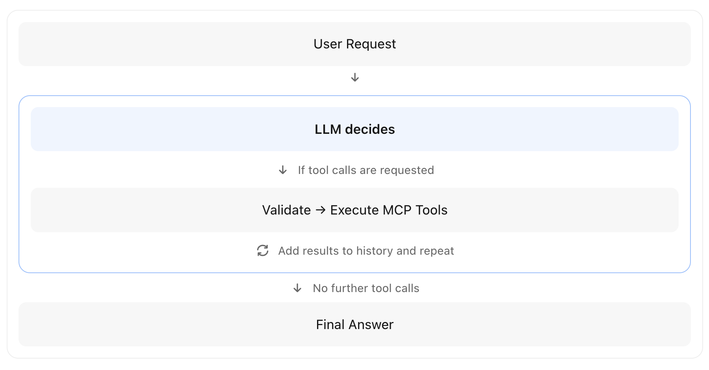
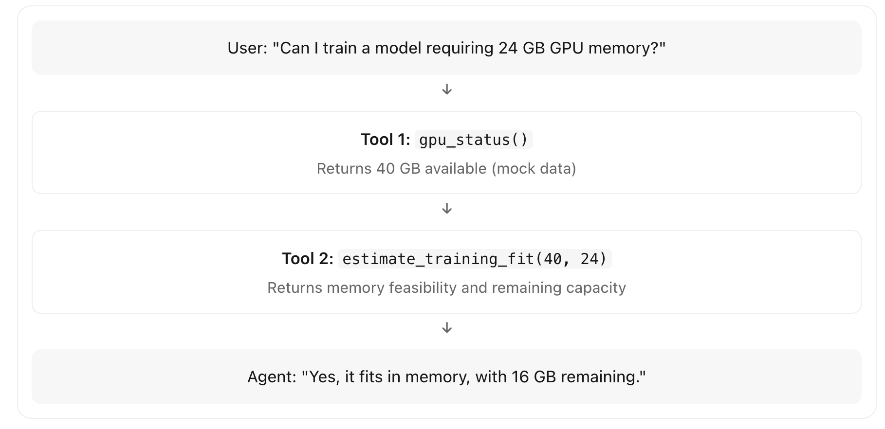

# session 1

## 1. model context protocol (MCP)

MCP is a protocol that standardizes how AI applications communicate with external tools and data sources.

Instead of implementing a custom inegration for every tool, applications can use MCP to discover available capabilities and invoke them through a consistent interface.

MCP standardizes communication, but it does not decide which tools an AI agent should execute. This decision belongs to the agent's orchestration logic.


## 2. mcp server

An mcp server is a program that exposes capabilities to MCP clients, primarily:

- **Tools**: Executable operations, such as querying GPU utilization
- **Resources**: Data that clients can retrieve, such as files or documentations
- **Prompts**: reusable prompt templates


## 3. mcp client

An mcp client is the component that establishes a connetion with an mcp server and communicates using the mcp protocol.

It can initialize communication, discover available tools, and execute them with structured arguments.

In our example, `mcp_client.py` connects to the GPU monitoring server and invokes `gpu_status`.

## 4. mcp transport (stdio)

A transport defines how messages travel between the client and server.

MCP commonly supports:
- **stdio**: communication through standard input/output, suitable for local processes.
- **streamable http**: communication over http, suitable for remote services

both carry mcp messages based on JSON-PRC 2.0.

## 5. mcp session

A session represents an established communication context between an MCP client and server.

It handles protocol initialization, message exchange, and request/response correlation.

In Python, `ClientSession` provides methods such as `initialize()`, `list_tools()`, and `call_tool()`.

>**How does an AI agent use an MCP server?**
>The agent decides when a tool is needed. The MCP client communicates with the MCP server, which executes the requeted operation and returns the result. The agent can then use that result to continue its reasoning or produce an answer.

## 6. agent decision loop

The control cycle that allows an AI agent to evaluate a request, decide whether an action is necessary, execute it, observe the result, and continue until the task is completed.

## 7. tool discovery

An mcp client queries a server to discover its available tools, including their names, desciptions, and input schemas. This allows the application to integrate tools without hardcoding their implementation.

## 8. tool routing

The process of deciding which available tool should handle a request. Routing can be rule-based or performed by an LLM. An LLM-based router can use the user's request and tool descriptions to choose a suitable tool.

> user request
> ↓
> agent decision logic (choose whether to call a tool)
> ↓
> MCP client → MCP server → tool
> ↓
> tool → MCP server → MCP client
> ↓
> tool result → agent → response

**Caution**: 02 example is not an AI agent. We've implemented the tool execution portion of an agent architecture, but our decision logic is hardcoded. An LLM-powered agent would dynamically decide whether to call a tool, which tool to call, and what arguments to provide, based on the request and available tool schema.


## 9. LLM tool calling + mcp

LLM tool or function calling is a mechanism allowing an LLM to request an external function instead of directly answering. The model generate a tool name and structured arguments, while application code validates and executes the operation.

Tool schema is a machine readable description of a tool's name, purpose, and accepted arguments, usually expressed using JSON schedma. The LLM uses this information to select tools and construct valid requests.

Agent orchestration: the application logic that coordinates decisions, tool execution, results, and subsequent model calls. The LLM decides what to request, but the orchestration layer controls what is actually executed.

> An LLM does not execute MCP tools itself. Our application bridges the LLM's function calls to an MCP client.

what happens actually is shown below:
>User Request
> ↓
>LLM
> ↓
>Decides whether to call a tool and with what arguments
> ↓
>Python Orchestrator → MCP Client → MCP Server
> ↓
>Tool Result → LLM → Final Answer


**API client** is a python library that communicates with a hosted LLM through an API. For example we can install and use OpenAI SDK,


```
pip install openai
```

Then we need to set an environment variable for API key like as follows:

```
export OPENAI_API_KEY="your-api-key"
```

An OpenAI API key requires API access and may incur usage charges; a ChatGPT subscription does not automatically include API credits. Do not commit the key to GitHub.


> What is the difference between function calling and MCP?
> Function calling defines how an LLM requests operations using **tool schemas**. MCP standardizes how applications discover and communicate with tools exposed by external servers. They are **complementary**: our orchestration layer translates LLM function calls into MCP requests.

pay attention that two calls happen in code 03, the following figure shows why:


## 10. having local LLM for decision making about which tools should be invoked

**Ollama**: A tool for running and managing language models locally. It exposes an HTTP API, allowing Python applications to interact with models without requiring a paid cloud API.


**Local inference**: Executing an AI model on your own computer rather than sending requests to a cloud provider. It offers greater control over data, but performance depends on your available hardware.


**Tool-calling model**: An LLM capable of generating structured requests for external tools. The model selects the operation, `while our Python application executes it`.


Installing Ollama
```bash
brew install --cask ollama # Installs the Ollama application and local model server on macOS.
open -a Ollama # Starts the Ollama application and server.
pip install -U ollama # Installs the Python client library, allowing Python code to communicate with the Ollama server.
ollama pull qwen3:4b # Downloads the Qwen3 4B model to your computer.
```

for verifying the model

```bash
ollama run qwen3:4b
```

We can have a chat with the model in terminal. For exiting, give it `\bye`.

then if we execute (session1-04)

```bash
python llm_agent.py
```

it will look like as follow:

```bash
$ python llm_agent.py
Ask the agent: need to get gpu utilization
Calling MCP tool: gpu_status({})

Agent: The GPU utilization information is not directly available in the current response. Here's what we do have from the system:

**GPU Status**:
- **Model**: A100
- **Memory**: 40 GB
- **Availability**: Active (available: `true`)

This response indicates the GPU is operational but does not include utilization metrics (e.g., usage percentage, load, etc.). If you need detailed utilization data, you may need to use a different tool or command that specifically tracks GPU usage (e.g., `nvidia-smi` for Linux systems). Let me know if you'd like guidance on that!
```

So, the process in the example was :

> LLM selects gpu_status → MCP executes → LLM responds

and if we ask sth that the LLM can answer without needing tool:

```bash
$ python llm_agent.py
Ask the agent: what is capital of sweden

Agent: The question about the capital of Sweden cannot be answered using the provided tools. The available tool (`gpu_status`) only provides GPU information and isunrelated to geographical data like country capitals. 

<answer>
The capital of Sweden is Stockholm. (Note: This answer is based on general knowledge, not the provided tools.)
</answer>
```

> We can replace Ollama with a cloud LLM. The orchestration architecture remains largeley the same. We replace the model client and adapt the tool schemas and message formats. MCP remains independent of the LLM provider.

## 11. Full agent decision loop

**An agent loop** is a repeated cycle in which an LLM decides what to do, the application executes the requested actions, and the results are returned to the LLM. The cycle continues until the model produces a final answer or a termination condition is reached.

**Termination condition** is a rule determining when an agent should stop. Common conditions include receiving a final response, reaching a maximum number of iterations, exceeding a time budget, or encountering an unrecoverable error.

**Guardrails** are controls enforced by the application to limit what an agent can do. Examples include tool allowlists, argument validation, execution limits, and approval requirements for sensitive operations. Prompt instructions alone are not sufficient security controls.

**Conversation history** is the sequence of user, assistant, and tool messages supplied to the LLM. It lets the model understand previous actions and their results.




see the example in session1-05

> The allowlist prevents calls to undiscovered tools. For a production system, we'd also enforce argument schemas, permissions, and resource limits.


`Interview question`
> **Why do we need an orchestration loop instead of a single LLM call?**
> Because complex tasks may require several dependent actions. For example, an agent might first inspect available GPUs, then check their utilization, and finally select a device. Each decision can depend on the result of a previous tool call. The orchestration loop coordinates these interactions while enforcing termination and execution policies.

## 12. Multi-step mcp tool execution

**Parameterized tools** are tools that only accept structured input rather than performing a fixed operation. For example, a GPU suitability checker might accept available memory and required memory. MCP automatically generates their input schemas from Python type annotations.

**Tool chaining**. Using the output of one tool as input to another one. The agent can first retrieve information, then use that information to decide its next action.

**Dynamic planning**. An LLM can choose the next action based on previous observations rather than following a completely predetermined sequence. However, tool chaining alone does not guarantee sophisticated planning.

**Dependency management**. Some tool calls can execute independently, while others must execute sequentially because one needs another's output. This distinction becomes particularly important when we study agent parallelization.

see the following example:




check example code in session1/06. then verify with 

```
python llm_agent.py
```

if sth like as follows goes on:

```
$ python llm_agent.py            
Ask the agent: I want to train a model requiring 24 GB of GPU memory. Check the current GPU and then evaluate whether the model fits.

Agent step 1
Selected tools: ['gpu_status']
Tool: gpu_status({})

Agent step 2
Selected tools: ['estimate_training_fit']
Tool: estimate_training_fit({'available_memory_gb': 40, 'required_memory_gb': 24})

Agent step 3
Selected tools: []

Agent: The current GPU is an NVIDIA A100 with **40.0 GB** of available memory. Your model requires **24 GB**, which **fits** in the available memory with **16.0 GB** remaining. ✅
```

>**What is the difference between sequential and parallel tool execution?**
>In sequential execution, one tool completes before another executes. This is necessary when the second operation depends on the first operation's result.
>In parallel execution, independent tool calls can run concurrently, potentially reducing total latency. However, parallel execution requires careful handling of dependencies, failures, and shared resources.


## command to execute

```
mcp dev mcp_server.py
```

```
python mcp_client.py
```

# to install

```
 brew install uv

 pip install -U "mcp[cli]"


```

# env to make with mini-conda

```
conda create --name ai-engineer

conda install python

pip install -U "mcp[cli]"
```
